# 📈 HengSeng Sentiment Price Prediction Agent

[](https://www.python.org/downloads/release/python-3120/)
[](tests/)
[](config.yaml)
[](src/models/validator.py)
[](src/features/aligner.py)
[](LICENSE)

An institutional-grade, multi-exchange quantitative machine learning pipeline that predicts next-bar intraday returns ($R_{t+1}$) for mega-cap equities across the **Hong Kong Stock Exchange (HKEX)** and the **Korea Exchange (KRX)**. The system continuously ingests social media discussions (Apify), neural financial news (Exa.com), and intraday market structure (1-hour OHLCV bars) under **strict causal point-in-time alignment, walk-forward cross-validation, and rigorous hypothesis testing**.

Developed for the **CrowdWisdomTrading** *HengSeng Sentiment Price Prediction Agent* assessment.

---

## 📑 Table of Contents
- [Executive Summary & Scope](#-executive-summary--scope)
- [System Architecture](#-system-architecture)
- [Cross-Source Execution Registry](#-cross-source-execution-registry)
- [Mathematical & Algorithmic Formulation](#-mathematical--algorithmic-formulation)
  - [1. Evaluation Window vs. Indicator Warm-Up](#1-evaluation-window-vs-indicator-warm-up)
  - [2. Point-in-Time Alignment & Exponential Decay](#2-point-in-time-alignment--exponential-decay)
  - [3. Non-Collinear Differential Sentiment](#3-non-collinear-differential-sentiment)
  - [4. Regularized Modeling & Volatility Clamping](#4-regularized-modeling--volatility-clamping)
- [Empirical Results & Ablation Analysis](#-empirical-results--ablation-analysis)
  - [Pooled Exchange Walk-Forward Validation](#1-pooled-exchange-walk-forward-validation-n--100)
  - [Per-Ticker Walk-Forward Ablation](#2-per-ticker-walk-forward-ablation)
  - [Out-of-Sample Predictions vs. Actual Price Action](#3-out-of-sample-predictions-vs-actual-price-action)
- [Interactive HTML Report Showcase](#-interactive-html-report-showcase)
- [Honest Scientific Limitations](#-honest-scientific-limitations)
- [Quickstart & Reviewer Reproduction](#-quickstart--reviewer-reproduction)
- [Project Directory Structure](#-project-directory-structure)

---

## 📌 Executive Summary & Scope

| Parameter | Hong Kong Exchange (HKEX) | Korea Exchange (KRX) |
| :--- | :--- | :--- |
| **Assets Analyzed** | `0700.HK` (Tencent)<br>`9988.HK` (Alibaba)<br>`0005.HK` (HSBC)<br>`1299.HK` (AIA Group)<br>`3690.HK` (Meituan) | `005930.KS` (Samsung Electronics)<br>`000660.KS` (SK Hynix)<br>`035420.KS` (Naver)<br>`005380.KS` (Hyundai Motor)<br>`035720.KS` (Kakao) |
| **Trading Sessions** | 5 sessions (`2026-11-02` to `2026-11-06`) | 5 sessions (`2026-11-02` to `2026-11-06`) |
| **Intraday Bar Resolution** | 1-Hour OHLCV (35 evaluation bars) | 1-Hour OHLCV (30 evaluation bars) |
| **Primary Social UGC** | **LIHKG** (連登 user discussion forum) | **Naver Finance 종목토론실** (retail discussion boards) |
| **News Wire Sources** | **AASTOCKS** (阿思達克 real-time wire) | **Daum Finance News** & **Naver Corporate News** |
| **Neural Semantic News** | **Exa.com Neural News Search** | **Exa.com Neural News Search** |
| **Currency Representation** | Hong Kong Dollar (`HK$`) | South Korean Won (`₩`) |

---

## 🏗 System Architecture

```mermaid
flowchart TD
    subgraph INGEST["1. Data Ingestion Layer"]
        A1["Apify: LIHKG (HKEX UGC)"]
        A2["Apify: AAStocks (HKEX News)"]
        A3["Apify: Naver Discussion (KRX UGC)"]
        A4["Apify: Daum Finance (KRX News)"]
        E1["Exa.com: Neural News Search (Both)"]
        P1["yfinance: 1h OHLCV Bars + Warm-Up"]
    end

    subgraph ALIGN["2. Zero-Lookahead Causal Alignment Layer"]
        B1["Point-in-Time Join: t_post in (T_k-1, T_k]"]
        B2["Market Closure Session Rollover (Overnight/Weekend)"]
        B3["Half-Life Exponential Decay: H = 6h"]
    end

    subgraph FEAT["3. Feature Engineering & Structure"]
        C1["Differential Bull/Bear: (Bull - Bear)/(Bull + Bear + 1)"]
        C2["Floor Trader Pivots (P, R1, S1) + Divergence Alerts"]
        C3["Lagged Log Returns & Rolling Volatility"]
        C4["Zero-Variance & Collinearity Drop"]
    end

    subgraph MODEL["4. Walk-Forward CV & Model Architecture"]
        D1["TimeSeriesSplit (4 expanding folds, zero future leak)"]
        D2["RidgeCV (fold-internal alpha tuning: 10^-2 to 10^4)"]
        D3["Volatility-Bounded Clamping: +/- 3 x Rolling Vol"]
        D4["Pooled Exchange Normalization (N > 100)"]
    end

    subgraph EVAL["5. Validation & Reporting"]
        R1["Naive Zero-Return Benchmark MAE"]
        R2["Binomial Directional Significance Test (vs 50% & Up)"]
        R3["Self-Contained Interactive Dashboard: report/report.html"]
    end

    INGEST --> ALIGN --> FEAT --> MODEL --> EVAL
```



---

## 📡 Cross-Source Execution Registry

Every data source was queried against live APIs, audited, and cataloged. Unviable actors and platform constraints are reported transparently:

| Exchange | Platform / Source | Category | Usable Window Items | Execution Status | Reference & Apify Run ID |
| :--- | :--- | :--- | :---: | :--- | :--- |
| **HKEX** | **LIHKG** (連登) | Social UGC | **4** | **Real Apify Run** *(Single thin UGC source)* | `GZVVLlijW4U5bxSNk` / `sKCe3NgXqlRDerEwZ` |
| **HKEX** | **AAStocks** (阿思達克) | News Wire | **36** | **Real Apify Run** *(Real-time public wire)* | `ZIhFu2IJARtAxAjbT` / `BNtpwWW3Uf1EfmBrA` |
| **HKEX** | **Exa.com News** | News Media | **58** | **Real Exa Search** *(Neural semantic search)* | Neural queries via `exa_py` |
| **HKEX** | **Futu / Moomoo** | Social UGC | **0** | **Unavailable** *(0 Apify actors exist on store)* | Queried `client.store().list(search="futu")` |
| **HKEX** | **ETNet HK Forum** | Social UGC | **0** | **Unavailable** *(0 Apify actors exist on store)* | Queried `client.store().list(search="etnet")` |
| **KRX** | **Naver 종목토론실** | Social UGC | **400** | **Real Apify Run** *(Retail stock discussion)* | `XDZAwjTEizX7OUn3n` / `tTfXyhIOFxdYMry5a` |
| **KRX** | **TeamBlind** | Social UGC | **0** | **Dataset Locked** *(Runs succeeded, locked by quota)* | `ygXvOJdSq4PWogaq1`, `hPs1ejWbCNS7SZmh4` |
| **KRX** | **Daum Finance News**| News Wire | **200** | **Real Apify Run** *(Finance section wire)* | `8cEgcwpp0ngIPkZzL` / `2cEGcNBbXozT9bMxe` |
| **KRX** | **Naver Corporate News**| News Wire | **37** | **Real Ingestion** *(Real-time corporate feed)* | Automated news feed ingestion |
| **KRX** | **Exa.com News** | News Media | **56** | **Real Exa Search** *(Neural semantic search)* | Neural queries via `exa_py` |
| **KRX** | **Telegram Channels**| Social UGC | **0** | **Failed** *(Login wall / web preview disabled)* | `cb05PcLkOCbpuiaSs`, `rJObXtQNc5uxUWNcB` |

### Ingestion Transparency & Data Governance
1. **Hong Kong UGC Scarcity**: HKEX retail sentiment is sparse because Futu/Moomoo and ETNet have no public Apify scrapers, and AAStocks exposes exclusively editorial news wires. LIHKG serves as the sole user-discussion source (4 high-engagement threads spanning the 10-day period).
2. **TeamBlind Dataset Locking**: Live Apify runs for TeamBlind succeeded on Apify's cluster (`hypebridge/blind-post-scraper`), extracting 60 items per ticker. However, TeamBlind outputs relative timestamps (`"2d"`, `"Yesterday"`), which raised a format error in the initial parser. Immediately after, the Apify free-tier quota ($5.00) was exhausted ($9.60 consumed), locking the datasets on Apify's servers. These runs were **never downloaded to cache and are not used** in features or models.
3. **Exa News Targeted Retries**: Default queries initially returned 0 results for AIA (`1299.HK`) and Meituan (`3690.HK`). Retrying those tickers with semantic query phrasing (`f"{ticker.name} Hong Kong stock"`, using exactly 2 Exa API calls) retrieved 22 verified articles for AIA and 22 for Meituan, lifting total HKEX Exa news volume to 58.

---

## ⚡ Mathematical & Algorithmic Formulation

### 1. Evaluation Window vs. Indicator Warm-Up
* **Evaluation Window**: Strictly bounded to the last 10 calendar days ending at execution timestamp ($T_0 - 10\text{d} \to T_0$).
* **Indicator Warm-Up Partitioning**: Pre-window price history ($T < T_{\text{start}}$) is fetched exclusively to seed technical indicators (14-period rolling volatility, moving average spreads, volume z-scores) and is **strictly purged** prior to model training, cross-validation, and performance accounting.

### 2. Point-in-Time Alignment & Exponential Decay
For an hourly bar $k$ bounded by $(T_{k-1}, T_k]$:
$$\text{Eligible Content: } t_{\text{item}} \in (T_{k-1}, T_k]$$
* **Market Closure Rollover**: Posts created while markets are closed (overnight, weekends) strictly accumulate into the opening bar ($09:30\text{--}10:30$ for HKEX, $09:00\text{--}10:00$ for KRX) of the subsequent active session.
* **Continuous Exponential Decay**: Inactive bars decay accumulated sentiment with half-life $H = 6\text{ bars}$ (1 trading day):
$$S_k = \begin{cases} s_k & \text{if new items observed in bar } k \\ S_{k-1} \cdot \exp\left(-\frac{\ln 2}{H}\right) & \text{if no items observed} \end{cases}$$

### 3. Non-Collinear Differential Sentiment
To avoid numerical instability from zero-division in standard bull/bear ratios, we formulate the bounded **Differential Sentiment Ratio**:
$$\text{DiffSentiment} = \frac{\text{Bullish} - \text{Bearish}}{\text{Bullish} + \text{Bearish} + 1.0} \in [-1, 1]$$
Collinear features (`social_sentiment_momentum`, `news_sentiment_smooth_3h`) and zero-variance features are systematically pruned prior to estimation.

### 4. Regularized Modeling & Volatility Clamping
* **Expanding-Window Cross Validation**: Evaluated using `TimeSeriesSplit(n_splits=4)` ensuring strictly causal out-of-sample forecasting.
* **Fold-Internal Regularization**: Ridge regression regularizer $\alpha$ is tuned strictly on training folds via `RidgeCV(alphas=np.logspace(-2, 4, 15))`.
* **Volatility-Bounded Clamping**: To eradicate unrealistic predictions (e.g. $+6.4\%$ hourly return predictions), forecasts are clamped to $\pm 3\times$ the rolling standard deviation:
$$\hat{R}_{t+1} \in \left[-3\sigma_{\text{roll}}, +3\sigma_{\text{roll}}\right]$$
All predicted hourly returns are bounded within $[-0.94\%, +0.64\%]$.

---

## 📊 Empirical Results & Ablation Analysis

### 1. Pooled Exchange Walk-Forward Validation ($N > 100$)
Cross-sectional models trained by pooling standardized return and sentiment series across all 5 assets within each exchange:

| Exchange | Test Samples $N$ | Naive Zero MAE | Price Only MAE | +Social MAE | +News MAE | All Features MAE | Optimal Predictor |
| :--- | :---: | :---: | :---: | :---: | :---: | :---: | :--- |
| **HKEX** | 136 | **0.006258** | 0.007241 | 0.007314 | 0.007048 | 0.006989 | **Naive Zero-Return** |
| **KRX** | 116 | **0.015071** | 0.016891 | 0.016891 | 0.018140 | 0.018140 | **Naive Zero-Return** |

### 2. Per-Ticker Walk-Forward Ablation

| Asset | Test Bars $N$ | Naive Zero MAE | Price Only MAE | +Social MAE | +News MAE | All Features MAE | Model Dir Acc | Always-Up | Prev-Dir | Binomial $p$-val (50%) | Sig Edge? |
| :--- | :---: | :---: | :---: | :---: | :---: | :---: | :---: | :---: | :---: | :---: | :---: |
| **0700.HK** (Tencent) | 24 | **0.006676** | 0.006913 | 0.006913 | 0.006912 | 0.006913 | **58.3%** | 58.3% | 54.2% | 0.2706 | **NO** |
| **9988.HK** (Alibaba) | 24 | **0.009013** | 0.009423 | 0.009423 | 0.009410 | 0.009410 | **41.7%** | 58.3% | 45.8% | 0.8463 | **NO** |
| **0005.HK** (HSBC) | 24 | **0.003970** | 0.004760 | 0.004760 | 0.004990 | 0.004990 | **41.7%** | 41.7% | 54.2% | 0.8463 | **NO** |
| **1299.HK** (AIA) | 24 | **0.003522** | 0.004196 | 0.004196 | 0.004137 | 0.004137 | **41.7%** | 45.8% | 45.8% | 0.8463 | **NO** |
| **3690.HK** (Meituan) | 24 | **0.009820** | 0.010720 | 0.010720 | 0.010721 | 0.010721 | **54.2%** | 54.2% | 45.8% | 0.4194 | **NO** |
| **005930.KS** (Samsung) | 20 | **0.018994** | 0.030130 | 0.030130 | 0.019039 | 0.019039 | **55.0%** | 40.0% | 45.0% | 0.4119 | **NO** |
| **000660.KS** (SK Hynix) | 20 | **0.025366** | 0.025354 | 0.025354 | 0.023924 | 0.023924 | **65.0%** | 35.0% | 50.0% | 0.1316 | **NO** |
| **035420.KS** (Naver) | 20 | **0.011225** | 0.012446 | 0.012446 | 0.015329 | 0.015329 | **40.0%** | 55.0% | 75.0% | 0.8684 | **NO** |
| **005380.KS** (Hyundai) | 20 | **0.014499** | 0.018964 | 0.018964 | 0.020120 | 0.020120 | **40.0%** | 55.0% | 55.0% | 0.8684 | **NO** |
| **035720.KS** (Kakao) | 20 | **0.011537** | 0.012761 | 0.012761 | 0.013362 | 0.013362 | **40.0%** | 65.0% | 55.0% | 0.8684 | **NO** |

### 3. Out-of-Sample Predictions vs. Actual Price Action

Next-bar ($n+1$) out-of-sample predictions formatted with local currency symbols (`HK$` and `₩`):

| Ticker | Current Close | Predicted Next Bar | Actual Next Bar | Predicted Return | Actual Return | Directional Hit? |
| :--- | :--- | :--- | :--- | :---: | :---: | :---: |
| **0700.HK** | HK$418.00 | HK$419.27 | HK$419.80 | +0.305% | +0.431% | **YES** |
| **9988.HK** | HK$104.30 | HK$104.60 | HK$104.90 | +0.291% | +0.575% | **YES** |
| **0005.HK** | HK$137.80 | HK$138.04 | HK$137.50 | +0.172% | -0.218% | **NO** |
| **1299.HK** | HK$78.45 | HK$78.59 | HK$78.45 | +0.178% | +0.000% | **NO** |
| **3690.HK** | HK$80.05 | HK$80.45 | HK$80.40 | +0.495% | +0.437% | **YES** |
| **005930.KS** | ₩189,900 | ₩188,466 | ₩190,400 | -0.755% | +0.263% | **NO** |
| **000660.KS** | ₩1,145,000 | ₩1,134,232 | ₩1,144,000 | -0.940% | -0.087% | **YES** |
| **035420.KS** | ₩192,700 | ₩193,759 | ₩192,400 | +0.549% | -0.156% | **NO** |
| **005380.KS** | ₩283,500 | ₩285,321 | ₩282,500 | +0.642% | -0.353% | **NO** |
| **035720.KS** | ₩32,950 | ₩32,995 | ₩32,450 | +0.136% | -1.517% | **NO** |

---

## 🎨 Interactive HTML Report Showcase

The pipeline compiles a production-grade, self-contained HTML dashboard at [`report/report.html`](report/report.html) featuring:
1. **Interactive Candlestick & Technical Level Charts**: Built with Plotly Dark theme, rendering 1h candles alongside daily Floor Trader Pivot points ($P$, $R_1$, $S_1$) and technical divergence alerts.
2. **Sentiment Decay Dynamics Subplots**: Displays synchronized point-in-time sentiment scores decaying exponentially during quiet hours.
3. **Cross-Source Provenance Matrix**: Full traceability table displaying the source, platform, native timestamp field, and window item count.
4. **Walk-Forward Performance Panels**: Visual bar charts comparing baseline MAEs with binomial significance test metrics.

---

## 🔍 Honest Scientific Limitations

1. **Short Evaluation Window**: The 10-calendar-day mandate limits the test dataset to 5 trading sessions (35 bars for HKEX, 30 for KRX).
2. **Statistical Alpha Rejection ($p \ge 0.05$)**: Across all 10 equities and pooled exchange models, directional accuracy against a 50% random guessing benchmark yields binomial $p$-values exceeding $0.05$. We explicitly reject the hypothesis that retail sentiment provides directional edge at 1-hour resolution.
3. **Optimality of Zero-Return Benchmark**: In low-signal intraday regimes where mean return $\mu \approx 0$, the **Naive Zero-Return baseline strictly minimizes MAE** compared to linear and regularized sentiment regressions.
4. **Apify Monthly Free-Tier Limits**: Live scraping reached the $5.00 free tier limit ($9.60 consumed). Scraper calls are disabled until reset on 2026-12-08. Reviewer reproduction is guaranteed via the committed `--use-sample` dataset.

---

## 🚀 Quickstart & Reviewer Reproduction

### 1. Installation
Clone the repository and install the pinned dependencies:
```bash
git clone https://github.com/Nimonium/hengseng-sentiment-price-agent.git
cd hengseng-sentiment-price-agent
pip install -r requirements.txt
```

### 2. Run Test Suite
Execute the 9 unit tests covering boundary conditions, zero-lookahead alignment, multilingual scoring, and pivot calculations:
```bash
pytest -v
```

### 3. Reviewer Reproducibility Mode (Zero API Tokens Required)
Run the complete pipeline end-to-end using the committed, pre-cached sample dataset in `data/sample/`:
```bash
python main.py --run all --use-sample
```
* Bypasses external network calls.
* Executes feature alignment, walk-forward CV, ablation analysis, and regenerated [`report/report.html`](report/report.html).

### 4. Live Scraper Execution (Requires `.env`)
To run with live Apify and Exa APIs (once billing reset or active subscription is configured):
```bash
cp .env.example .env
# Edit .env with your APIFY_TOKEN and EXA_API_KEY
python main.py --run all
```

---

## 📁 Project Directory Structure

```text
hengseng-sentiment-price-agent/
├── .env.example              # Sanitized credentials template (no secrets committed)
├── .gitignore                # Protects .env, data/raw, and local scratch files
├── ACTORS.md                 # Complete registry of Apify actors, schemas, and run IDs
├── README.md                 # Institutional documentation & empirical report
├── config.yaml               # Exchange schedules, ticker metadata, and model parameters
├── pytest.ini                # Pytest configuration
├── requirements.txt          # Pinned dependency versions
├── main.py                   # Central pipeline orchestration & CLI entry point
│
├── data/
│   └── sample/               # Committed sample dataset for zero-token reviewer mode (1.21 MB)
│       ├── news/             # Cleaned Exa news Parquet & JSON (10 tickers)
│       ├── prices/           # 1-hour OHLCV price bars (10 tickers)
│       └── social/           # LIHKG, AAStocks, Naver Discussion, Daum Parquet & JSON
│
├── report/
│   └── report.html           # Standalone interactive Plotly visual report (204 KB)
│
├── scripts/
│   └── dev/                  # Developer exploration, API audit, and clean-clone test scripts
│       └── run_clean_clone_test.py
│
├── src/
│   ├── config.py             # Strongly typed Pydantic configuration loader
│   ├── features/
│   │   ├── aligner.py        # Zero-lookahead causal point-in-time join & decay
│   │   ├── levels.py         # Floor Trader Pivot Points & divergence detector
│   │   └── technical.py      # Technical indicator engineering (RSI, ATR, Volatility)
│   ├── ingestion/
│   │   ├── apify_ingest.py   # Apify Actor integration with rate limiting & caching
│   │   ├── exa_news.py       # Exa.com neural semantic news search
│   │   ├── price_ingest.py   # Yahoo Finance 1h bar loader with warm-up partitioning
│   │   └── web_fallback.py   # Fallback scrapers (active only with --allow-fallback)
│   ├── models/
│   │   ├── baselines.py      # Naive Zero-Return, Always-Up, and Prev-Dir baselines
│   │   ├── trainer.py        # RidgeCV regression with bounded output clamping
│   │   └── validator.py      # Walk-forward cross validation & pooled exchange models
│   ├── report/
│   │   └── generator.py      # Plotly HTML report generator
│   └── sentiment/
│       ├── aggregator.py     # Engagement-weighted aggregation
│       └── scorer.py         # Multilingual sentiment scoring (VADER + Gemini)
│
└── tests/
    ├── test_alignment.py     # Causal boundary & zero-lookahead tests
    ├── test_levels.py        # Pivot point mathematical correctness tests
    ├── test_sentiment.py     # Multilingual scoring & aggregation tests
    └── test_validation.py    # Walk-forward cross validation & binomial test verification
```
